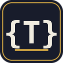

# JSON Typer

Paste JSON, get types. Select JSON in any editor (or copy it), run one command, and get typed code in your language of choice. Everything runs on your machine: no network calls, no telemetry, no account.

 

**Install:**

- **VSCodium, Cursor, Windsurf, Eclipse Theia and other Open VSX editors:** search "JSON Typer" in the Extensions view, or run `ext install kingaikits.json-typer`.
- **VS Code:** download the [.vsix from Open VSX](https://open-vsx.org/api/kingaikits/json-typer/1.0.0/file/kingaikits.json-typer-1.0.0.vsix), then Extensions view, `...` menu, **Install from VSIX...** (or `code --install-extension kingaikits.json-typer-1.0.0.vsix`).

Listing: https://open-vsx.org/extension/kingaikits/json-typer. Want Zod, Python, Rust, C# and Kotlin too? [Get Pro ($4.99, one-time)](https://buy.stripe.com/28E3co6zt7Ssew2cmT0x53B).

## How to use

1. Select some JSON (or leave nothing selected to use the whole file), or copy JSON to the clipboard.
2. Open the Command Palette (Ctrl+Shift+P / Cmd+Shift+P).
3. Run **JSON Typer: Generate Types from Selection or File** or **JSON Typer: Paste Clipboard JSON as Types**, then pick a language.

The result opens in a new tab beside your editor (or replaces your selection if you set `jsonTyper.output` to `insert`).

## Free vs Pro

| | Free | Pro |
|---|---|---|
| TypeScript (interface or type, optional `readonly`) | yes | yes |
| Go structs with `json` tags | yes | yes |
| JSON Schema (draft-07) | yes | yes |
| Zod schemas + inferred types | | yes |
| Python dataclasses | | yes |
| Python Pydantic models | | yes |
| Rust structs with serde | | yes |
| C# classes with `JsonPropertyName` | | yes |
| Kotlin `@Serializable` data classes | | yes |

Pro is a **one-time $4.99** unlock, no subscription: [buy Pro](https://buy.stripe.com/28E3co6zt7Ssew2cmT0x53B). Your key is shown on the confirmation page right after payment. Run **JSON Typer: Activate Pro Key**, paste it, done. The key is checked on your device and works offline.

Pro is a way to support the work. The source is MIT licensed; the key check is an honor-system gate, not copy protection.

## What it infers

- Arrays of objects are merged into one type; keys missing from some items become optional.
- `null` becomes a nullable type; mixed values become unions (`string | number`, `Union[...]`) or the language's catch-all.
- Whole numbers become integer types, other numbers become floating point.
- Names are derived from the keys (`orders` gives `Order`), with collisions numbered.
- Input may carry comments, trailing commas, or a leading `const data =` and trailing `;`.

## Settings

- `jsonTyper.rootName` (default `Root`)
- `jsonTyper.typescriptStyle`: `interface` or `type`
- `jsonTyper.readonlyFields`
- `jsonTyper.output`: `newTab` or `insert`

## Privacy

No network access, no telemetry. Your JSON never leaves your machine. The only stored value is your Pro key, in the extension's own storage.

## Support

hello@usekingai.com. Issues: https://github.com/kingworks-dev/json-typer/issues

Made by King AI (King Holdings Ventures LLC). MIT licensed.
